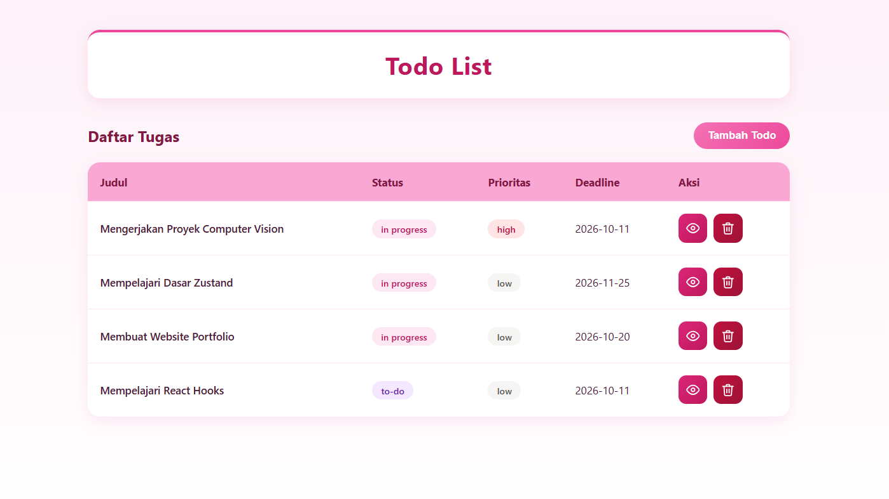
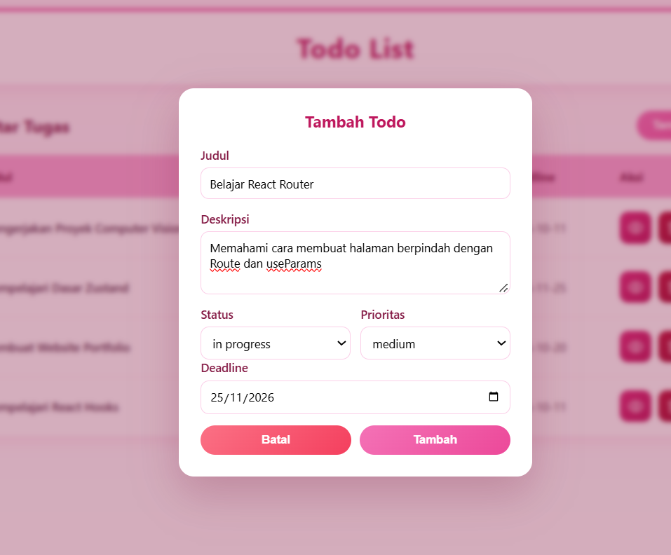
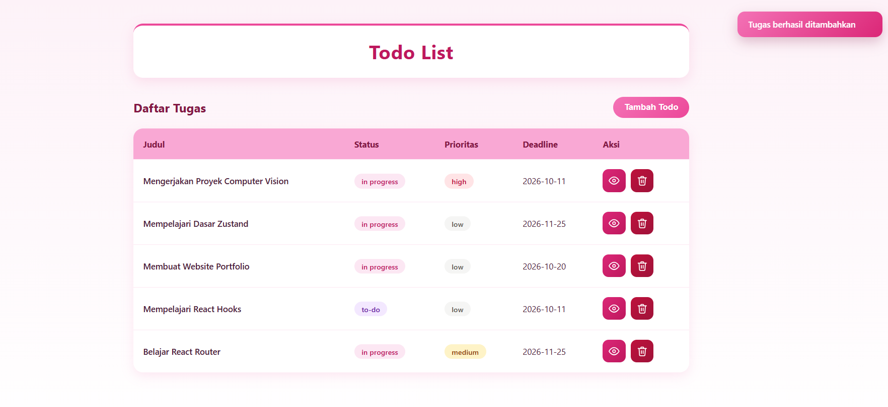
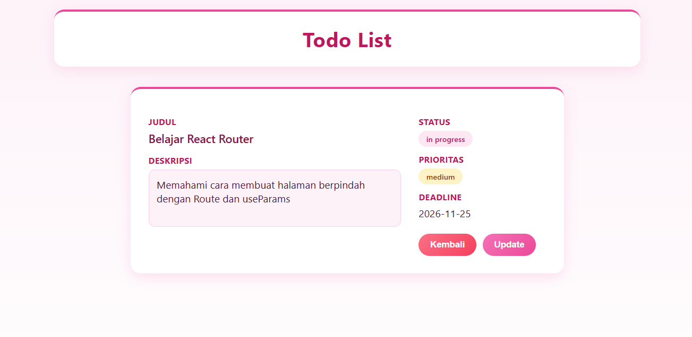
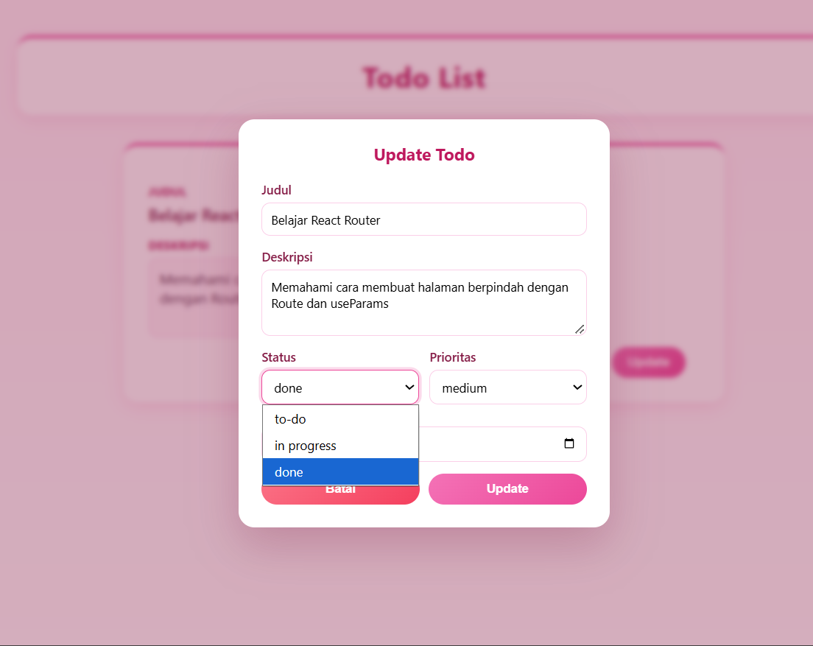
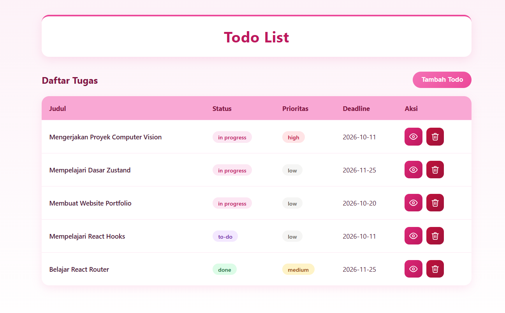
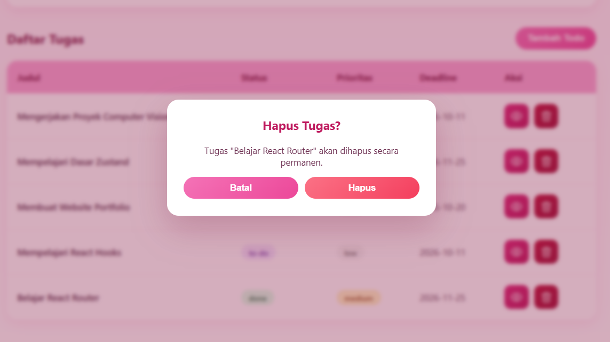
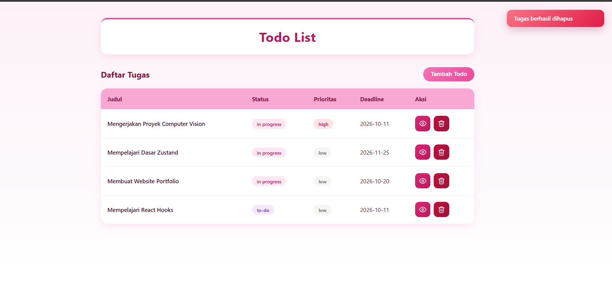

## Screenshot

### 01 Daftar Todo

### 02 Tambah Todo

### 03 Setelah Tambah Todo

### 04 Detail Todo

### 05 Update Todo

### 06 Setelah Update Todo

### 07 Konfirmasi Hapus

### 08 Setelah Hapus Todo
